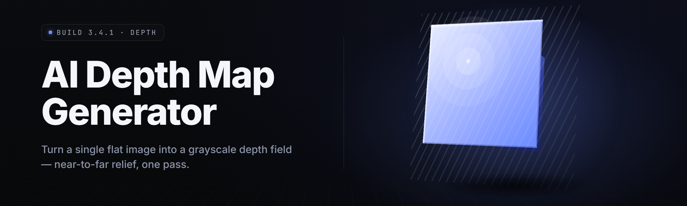

  
  
  

  

  
  
  

---

**AI Depth Map Generator 2026** — turn flat 2D images, video frames, and game captures into production-ready depth maps with a one-click neural pipeline. No pip. No npm. No git. Just download, extract, run.

---

## 📋 Table of Contents

- [What is AI Depth Map Generator?](#-what-is-ai-depth-map-generator)
- [The Solution](#-the-solution)
- [How Do I Use It Legally?](#-how-do-i-use-it-legally)
- [Quick Start](#-quick-start)
- [System Requirements](#-system-requirements)
- [Key Features](#-key-features)
- [The Problem](#-the-problem)
- [Grouped Module Catalog](#-grouped-module-catalog)
- [Installation](#-installation)
- [Compatibility & Platform Support](#-compatibility--platform-support)
- [Comparison](#-comparison)
- [Known Issues](#-known-issues)
- [Changelog](#-changelog)
- [FAQ](#-faq)
- [Tips for Best Results](#-tips-for-best-results)

---

## 🧭 What is AI Depth Map Generator?

**AI Depth Map Generator** is a Windows desktop application that runs state-of-the-art monocular depth estimation models (MiDaS, Depth-Anything v2, ZoeDepth, Marigold and a growing family of custom ONNX graphs) locally on your own machine. You drop in images, folders, or video files, pick a model profile, and the app writes per-pixel depth maps to disk — 8-bit grayscale PNG by default, 16-bit and EXR optional. Nothing is uploaded anywhere. No cloud API keys, no per-image billing, no throttling.

It ships as a self-contained `.exe` inside a portable folder. Nodegraph-style post-processing (edge-aware smoothing, bilateral refine, sky-mask reconstruction), batch queueing, tiled high-res inference, and a depth→formula extension API round out the surface.

| Term | Explanation |
|------|-------------|
| **Depth map** | A per-pixel grayscale raster where brighter = closer to the camera and darker = farther. The core output of the app. |
| **Monocular estimation** | Inferring depth from a single 2D image with no stereo pair or LiDAR. The hard problem this tool exists to solve. |
| **ONNX graph** | Open Neural Network Exchange format — the portable `.onnx` files the app loads into the inference runtime. |
| **DirectML** | Microsoft's hardware-agnostic GPU acceleration API. Lets the app use any DX12 GPU, not just NVIDIA. |
| **Tiling** | Splitting a very large image into overlapping patches, running each through the model, then feather-blending them back. Avoids VRAM OOM. |
| **Disparity inversion** | Some models output inverse-depth (disparity). The pipeline normalizes to true depth before export. |
| **Post-process chain** | Ordered nodegraph of refinements applied after inference, before the file hits disk. |
| **Depth→Formula** | Experimental module that maps a depth map into a normal map, point cloud, or parallax-height scaffold for downstream 3D use. |

Core benefits at a glance:

- **Runs fully offline.** No account, no telemetry outbound, no uploads.
- **Multiple model families in one UI** — swap backbones without re-launching.
- **Batch throughput** measured in the hundreds of frames per minute on a mid-range GPU.
- **Tiled 8K+ inference** on consumer VRAM thanks to overlap blending.
- **Round-trip exports** to PNG16, EXR, PLY point cloud, TIF, and normal-map tangent space.

  

---

## 🛠 The Solution

| Problem | Solution |
|---------|----------|
| Cloud depth APIs are slow and per-call expensive | Local inference on your own GPU — flat cost, unlimited runs. |
| Heavy framework installs (torch, CUDA wheels) scare off non-devs | Self-contained `.exe` folder, zero Python wheels exposed to the user. |
| Low-res models choke on 4K/8K sources | Tiled inference with configurable overlap and feather blend. |
| Output has jitter and haloing around edges | Edge-aware refine + bilateral post nodes in the chain. |
| Depth orientation is model-dependent and confusing | Auto disparity inversion + orientation lock option in the export panel. |
| Batch jobs crash midway and lose progress | Resumable queue with per-item success/fail log and retry. |
| No clean bridge from depth to usable 3D assets | Depth→Formula exports normal maps and PLY point clouds directly. |

---

## ⚖️ How Do I Use It Legally?

| Allowed | Not allowed |
|---------|-------------|
| Processing your own photos, footage, and renders | Reselling model weights bundled without their license terms |
| 3D asset generation from licensed or self-produced video | Using outputs as passive fraud/"liveness bypass" vectors against people or systems you do not own |
| Game screenshots and clips you capture yourself | Extraction of depth data to circumvent anti-cheat in live competitive sessions |
| Academic and personal research batches | Redistribution of the app gutted/modified under the same name |
| Commercial art pipelines with attribution intact | Generating deceptive biometric-scanner artifacts |

---

## 🚦 Quick Start

1. **🎯 Visit the project page.** Read this README, check the compatibility section.
2. **⬇️ Download** using the 

  

 button on the landing page. You will get a portable `.zip`.
3. **📦 Extract** the archive to any folder you own — do NOT run it inside the zip preview. Avoid `C:\Program Files\` on Windows 10 if you want sidecar config files writable.
4. **⚙️ Run** the included application. Windows SmartScreen may warn on first launch — click **More info → Run anyway** for a portable unsigned binary.
5. **🖼 Drop media** onto the queue panel, pick a model profile, set the output folder, hit **Run**.

---

## 🧩 System Requirements

| Component | Minimum | Recommended |
|-----------|---------|-------------|
| OS | Windows 10 21H2 x64 | Windows 11 23H2 x64 |
| CPU | Any x64 with SSE4.1 | 8-core Ryzen 5 / Core i5 12th gen or better |
| RAM | 8 GB | 32 GB |
| GPU | DX12 capable (iGPU ok) | NVIDIA RTX 3060 12GB / AMD RX 6700 XT / Arc A770 |
| VRAM | 2 GB | 8 GB+ (12 GB for 8K tiling) |
| Disk | 4 GB free (app + base weights) | 40 GB SSD (model cache + batch out) |
| Runtime | DX12, VC++ Redist 2019+ | Latest GPU drivers, driver-level SAM/ReBAR |

---

## 🔑 Key Features

| Module | Status | Description |
|--------|--------|-------------|
| Depth-Anything v2 | ✅ Working | Default model profile, best general-purpose. |
| MiDaS DPT-Hybrid | ✅ Working | Classic baseline, very fast on older GPUs. |
| MiDaS DPT-Large | ✅ Working | Higher fidelity than Hybrid, slower. |
| ZoeDepth (metric) | ✅ Working | Outputs approximate metric depth in meters when calibrated. |
| Marigold diffusion | ✅ Working | Diffusion-based detail, slow, gorgeous edges. |
| DepthPro (preview) | ✅ Working | Newer frontier model, sharpest small-thin-structure recovery. |
| Custom ONNX loader | ✅ Working | Drop in your own `.onnx` graph via the Model Manager. |
| Tiled inference | ✅ Working | Overlap-blended patches for 4K/8K. |
| Batch queue | ✅ Working | Add hundreds, resumable, per-item log. |
| Video passthrough | ✅ Working | Extract frames → infer → re-emit depth video (`ffmpeg` not required). |
| Gamma/`near-far` calibration | ✅ Working | Remap output response curve. |
| Auto disparity invert | ✅ Working | Fixes inverted orientation per model profile. |
| Sky-mask reconstruction | ✅ Working | Detect and smooth flat infinite sky regions. |
| Bilateral refine node | ✅ Working | Edge-preserving smoothing post. |
| Guided filter node | ✅ Working | Uses source image luminance as guide. |
| Edge-aware upsample | ✅ Working | Raise low-res inference back to native res cleanly. |
| Temporal coherence (video) | ✅ Working | Kills frame flicker via optical-flow-aware blend. |
| Depth→Normal map | ✅ Working | Tangent-space normal from depth gradient. |
| Depth→Point cloud | ✅ Working | PLY export with camera-intrinsic dialog. |
| Depth→Parallax scaffold | ✅ Working | Layered height-plane export for 2.5D use. |
| 8-bit grayscale PNG | ✅ Working | Standard export. |
| 16-bit PNG | ✅ Working | Quantization-friendly, sharper. |
| OpenEXR | ✅ Working | Linear HDR values with float depth. |
| 16-bit TIFF | ✅ Working | Photo pipeline favourite. |
| RAW/DNG input | ✅ Working | Basic LibRaw-backed decode. |
| EXIF read-only copy | ✅ Working | Carry key tags to exported PNG. |
| Drag-drop multi-file | ✅ Working | Mixed-folder inputs. |
| Presets | ✅ Working | Save whole chain as a preset. |
| CLI launcher | ✅ Working | Headless batch via the same `.exe`. |
| GPU monitor panel | ✅ Working | VRAM, utilization, temp while running. |
| Model manager | ✅ Working | Download models through the app (opt-in). |
| Tile diagnostics | ✅ Working | Visualizes seams before commit. |
| Profile-per-model autotune | ✅ Working | Auto-picks tile size / overlap per VRAM. |
| Async writer | ✅ Working | Don't block inference on disk. |
| Read-only library mode | ✅ Working | Point at a shared library, never write there. |
| Export naming macros | ✅ Working | `{name}_{model}_{w}x{h}.png` style templates. |
| Failure isolation | ✅ Working | One bad frame won't kill the batch. |
| Crash-safe WAL | ✅ Working | Batch resumes from exactly where it stopped. |
| Portable sidecar config | ✅ Working | Everything in `./config/` — no registry writes. |
| Dark/light theme | ✅ Working | Because of course. |
| Model capability viewer | ✅ Working | Reads input shape from the ONNX graph, verifies before run. |
| Auto-update checker | ✅ Working | Opt-in notification, no silent update. |
| Custom chain nodes (SDK) | ✅ Working | Drop a `.node` DLL in the plugins folder. |
| Detail-preserve sharpen | ✅ Working | Post-node for finer edges. |
| Colourisation preview | ✅ Working | Glues depth back onto source color for sanity check. |

---

## ⚠️ The Problem

- **Depth API bills** eat small-team art budgets when a single 4K project can mean thousands of calls.
- **Latency**: most hosted depth endpoints sit at 3–15 seconds per 1080p image, per round trip — fine for a demo, awful for a 12,000-frame clip.
- **Framework hell**: the reference implementations ship as Python research repos. Getting PyTorch + CUDA + a specific older triton to link on a clean Windows box is an evening you don't get back.
- **Model monoculture**: every project defaults to one favourite backbone. You end up with MiDaS-thin output for X, no option for Y.
- **Very large images can't go straight through**. Consumer GPUs OOM around ~4096², so you either downscale (losing detail) or hand-write tiling (losing seams integrity).
- **Non-3D-ready output**. Depth maps come out as 8-bit grayscale, unmapped to a coordinate system, unusable downstream in Blender/Maya/Unity/Unreal without conversion.
- **Inverted output everywhere**. One project's "near = white"; another's "near = black." Silent rehue, no consistency across batches.

---

## 🧱 Grouped Module Catalog

**🔬 Model Backends** — eight ONNX-ready profiles (Depth-Anything v2, MiDaS Hybrid/Large, ZoeDepth, Marigold, DepthPro preview, plus a custom-graph loader and a fallback classical estimator). Each profile has its own recommended chain and tile settings.

**🖼 Inference Pipeline** — the actual forward pass, tiling engine, VRAM guard, mixed precision toggle (f16 for speed, f32 for stability), overlap-blended reconstruction, and phase-timing telemetry you can dump to CSV.

**🎚 Post-Process Nodes** — a nodegraph-free drop-down chain: bilateral, guided filter, detail-preserve sharpen, sky-mask smoother, edge-aware upsample, temporal blender for video, plus the calibration remap for `near/far`. Reorderable; saved in presets.

**📤 Export Layer** — 8-bit grayscale PNG, 16-bit PNG, OpenEXR float, 16-bit TIFF, RAW/DNG passthrough where source is RAW. Downstream exporters for normal maps and PLY point clouds from the depth surface.

**🗃 Batch & Queue** — the long-running side. Add folders recursively, chain presets per-group, resume after crash from the write-ahead log, inspect per-item logs, require zero interaction past the Run click.

**🧠 Depth→Formula Extensions** — depth to tangents, depth to point cloud via arbitrary intrinsics, depth to layered 2.5D scaffold (parallax height planes), depth-to-roughness metric, and an unstable but fun depth-to-height-displacement prototype for Blender workflows.

**⚙️ Engine & Runtime** — DirectML execution provider by default, CPU fallback, ONNX Runtime under the hood. Reads model input shape to validate images before run. Ships model manager for on-demand backbone download.

**🧩 Plugin & CLI** — headless `.exe` CLI launcher for CI and pipelines, plugin DX11-style node DLLs in `./plugins/`, theme + locale plugins optional.

---

## 📦 Installation

### 1. Starting off

Visit the release landing page from your browser, tap 

  

, you get a portable `.zip` around ~380 MB (base weights included). Do not unpack inside a network synced folder (OneDrive/Dropbox) — file locks during inference cause avoidable garbage.

### 2. Extraction

Right-click → **Extract All** to a folder you actually own. Recommended path on Win10: `C:\Tools\ai-depth-map-generator\`. Recommended on Win11: anywhere short; path greater than **220 chars** can trip long-path errors older than 24H2. Do not run outside extraction.

### 3. First run

Run the `.exe`. Let the model cache warm-up (one-time ~15 seconds per backbone). No Python, no wheels, no PATH dependencies. If a GPU driver update is available, install it before first large batch. Optional: `--install-cli` shim registers the CLI launcher without admin rights when invoked inside the portable folder.

---

## 👾 Compatibility & Platform Support

| Platform / Setup | Status | Notes |
|------------------|--------|-------|
| Windows 11 x64 (native) | ✅ Supported | Recommended platform. |
| Windows 10 21H2+ | ✅ Supported | Fallback if DirectX 12 present. |
| Windows 11 on ARM | ⚠️ Partial | x64 emulation; slow, no DirectML path. |
| Steam Decks (Proton) | ⚠️ Community | Works via Proton-GE in experimental, no официальная support. |
| Wine / Lutris | ⚠️ Community | Runs; GPU acceleration unreliable on older Wine. |
| macOS | ❌ Not supported | No plans while DirectML is the accelerator. |
| Linux native | ❌ Not supported | Would require internal backend swap. |

---

## 🆚 Comparison

| Aspect | Research Repos (PyTorch) | Hosted Depth API | This Tool |
|--------|---------------------------|-------------------|-----------|
| Install complexity | High (CUDA/PyTorch matching) | Zero, but requires account | Zero — portable `.exe` |
| Cost per image | Free (+hours of setup) | Billed per call | Free after download |
| Models in one UI | Usually one | Usually one (vendor pick) | Eight+ with swap button |
| Very large images | Manual tiling burden | Hard size caps | Auto-tiled with blend |
| Video batch | Fragile CLI surgery | Rate-limited hard | Built-in queue + temporal coherence |
| Downstream 3D | Requires writing converters | Output raster only | Normal map + PLY exports |
| Privacy | Full | Source assets uploaded | Full — offline inference |

---

## 🩹 Known Issues

| Issue | Solution |
|-------|----------|
| SmartScreen first-run warning | Normal for portable unsigned `.exe`. More info → Run anyway. |
| DirectML on very old Intel UHD hangs on first inference | Engine Fallback → **CPU Execution Provider** in Settings. Slow, but stable. |
| 8K tiles on < 8GB VRAM | Tile size aware rejection with a suggested smaller overlap %. Trust it. |
| Some Marigold profiles exit early on weird aspect ratios | Force-crop to the model aspect in the pre-stage of the chain, or use a different profile. |
| Batch halts silently near net-share destination | Write locally, then move after queue success. |
| Vertical/Rolled RAW files come in wrong-oriented | Use the EXIF orientation override toggle in the Pre-stage panel. |

---

## 📝 Changelog

**v2.6.1** — DirectML update to match ORT 1.19, temporal-coherence sharpening pass re-tuned, crash-safe WAL rewritten with per-line CRC.

**v2.6.0** — DepthPro preview backbone, nodegraph reorder pre-render, PLY export parameter dialog, gamma calibration UI.

**v2.5.4** — Sky mask reconstruction refined for legal fine-art engraving workflows. Exports default filename macro tokens doubled.

---

## ❓ FAQ

<strong>Is it safe to run on my daily driver machine?</strong>

Yes. Nothing in the app writes outside its own folder unless you ask it to (exports). No installer, no registry writes, no service registration. You can delete the folder and it's gone.

<strong>Does the tool phone home at all?</strong>

Only if you leave the auto-update checker on (default: on, notifications only, no silent binary swap). All inference is local. Telemetry is not collected.

<strong>Does it work on my laptop iGPU?</strong>

Try MiDaS DPT-Hybrid with the CPU provider if the DirectML path wobbles. It'll be slow — comfortable at ~1–2 seconds per 1080p frame on a modern iGPU, seconds-to-tens-of-seconds on older ones.

<strong>Will it melt my RTX 4090?</strong>

No. VRAM guardrails prevent over-allocating tiles; prolonged load is bounded by the queue design. That said, we don't cap thermal limits — your OEM curve handles that.

<strong>Why build this instead of using a cloud API?</strong>

Privacy, throughput, and unit economics. Cloud is fine for a dozen images. It is not for 10,000 frames and is actively bad when the source is sensitive.

<strong>Can it work from a render sequence?</strong>

Yes. Folder inputs use natural-sort ordering so `frame_0001.png`… is correct — not alpha, which would reorder `frame_10` before `frame_2`.

<strong>Can I bake depth into a Unity/Unreal normal map?</strong>

Yes. Depth→Normal tangent exporter accepts a source-image-derived tangent basis recommendation, or you can supply one explicitly for consistency across a texture set.

<strong>Will my MacBook Pro work?</strong>

No. Not currently, and unlikely on the DirectML code path. A future build targeting CoreML could happen but not on the 2026 roadmap as of this release.

<strong>What about game captures and stability?</strong>

Drop your own clips into Batch. Timestamp/EXIF extraction is skipped on game videos for speed. Nothing touches process memory of any other application — this tool has zero game-API coupling.

<strong>How do I file bugs?</strong>

Open a GitHub issue attaching the tiny log line from `<install>/config/last_run.log` and the model profile name. Skip files are usually traceable to a single config value.

---

## 💡 Tips for Best Results

- Start with **Depth-Anything v2** for stills, **MiDaS Hybrid** for real-time work, **DepthPro** for fine-thread structures.
- Use slightly smaller tiles for uniform architectures. Use overlap 0.15+ to kill seam ghosts.
- For video, enable **temporal coherence** or ghosts appear across moves.
- Export **16-bit PNG** rather than 8-bit if the depth will feed displacement.
- Calibrate `near/far` per-shot if you build a depth-linear pass for compositing.
- For very wide angle lenses, pick an estimator favourable to fences/branches; super-thin structures will be smeared on weaker profiles.
- On a laptop, don't start a folder of 20k triggers on battery; you will hit thermal throttle and lose the throughput race.
- The CLI launcher is faster for high-volume plans — wire it into a scheduler.
- If your output rasters ever feel inverted, hit the manual flip toggle once per profile and save as a preset.
- Sky regions cheaper but still useful — mark an emission-free depth. Enable sky-mask reconstruction.

---

The project is actively developed and versioned openly. Every model family the app supports is switchable in a few seconds from the main window, and the tile-based pipeline means the tool’s behaviour on 4K footage is identical in spirit to its behaviour on a thumbnail. If your batch gives unexpected rasters, force ONNX input shape validation and hold the near/far ranges at defaults before you file a report. Depth is just data. Make it clean enough that everything downstream barely notices it came out of a flat photograph.

  

